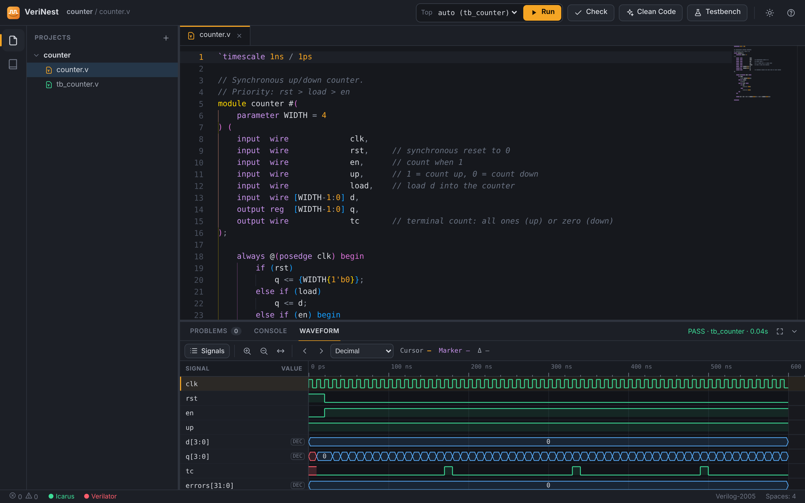

<div dir="rtl">

# VeriNest

یک محیط سبک و آفلاین برای **یادگیری و تست Verilog** روی لینوکس و ویندوز. کد ماژول را می‌نویسید، خطاها همان لحظه با توضیح نشان داده می‌شوند، با Icarus Verilog شبیه‌سازی می‌کنید و waveform را در همان پنجره می‌بینید.

[English](README.md)



## چرا VeriNest؟

Vivado و ModelSim سنگین‌اند و برای تمرین Verilog زیادی بزرگ‌اند. منظور تمرین‌هایی مثل جمع‌کننده، ضرب‌کنندهٔ بوث، ALU، FSM یا یک CPU ساده است. VeriNest ابزارهای رایگان Icarus Verilog و Verilator را داخل یک رابط مدرن و ساده می‌گذارد که برای یادگیری طراحی شده است:

- هر خطا یک **توضیح ساده** و **راه رفع** دارد؛
- ادیتور ادامهٔ کد را به شکل یک پیشنهاد کم‌رنگ نشان می‌دهد و با <kbd>Tab</kbd> یا <kbd>Enter</kbd> قبول می‌شود؛
- نمایشگر موج داخل خود برنامه است و GTKWave جداگانه لازم نیست؛
- کاملاً آفلاین کار می‌کند و چند صد مگابایت رم مصرف می‌کند.

## امکانات

- **ادیتور:** موتور ادیتور VS Code، رنگ‌بندی Verilog، تم تیره و روشن
- **پیشنهاد هوشمند:** اسکلت `always`، `begin/end`، `case` و `module`، اتصال کامل پورت‌های ماژول‌های خود پروژه، و تکمیل اسم سیگنال‌ها
- **ذخیرهٔ خودکار:** یک ثانیه بعد از توقف تایپ. با کلیک روی *Auto Save* در نوار پایین خاموش یا روشن می‌شود.
- **Clean Code:** با <kbd>Shift</kbd>+<kbd>Alt</kbd>+<kbd>F</kbd> تورفتگی و تراز اعلان‌ها مرتب می‌شود. فقط فاصله‌ها تغییر می‌کنند، پس کد خراب نمی‌شود.
- **بررسی خطا هنگام تایپ:** با Icarus، Verilator، و بررسی ساختار کد (مثلاً `begin` بی‌`end` یا `;` جاافتاده)
- **ساخت خودکار تست‌بنچ** از روی هر ماژول
- **شبیه‌سازی با F5:** خروجی کنسول با PASS/FAIL رنگی
- **نمایشگر موج:** zoom، cursor و marker، اندازه‌گیری فاصلهٔ زمانی، پرش بین لبه‌ها، نمایش مقدار به صورت bin/hex/dec/signed
- **۹ نمونهٔ آماده** با تست‌بنچ خودکار: Full Adder، Ripple-Carry، CLA، ALU، Booth، Register File، Counter، FSM و یک CPU ساده

## نصب

### ویندوز ۱۰ و ۱۱

فایل **`VeriNest-x.y.z-Setup.exe`** را از صفحهٔ [Releases](https://github.com/mortezapourhoseini/verinest/releases) دانلود و اجرا کنید. دسترسی Administrator لازم نیست و پایتون و Icarus Verilog داخل خود نصب‌کننده هستند. برنامه در یک پنجرهٔ مستقل Edge باز می‌شود. نسخهٔ portable (فایل zip) هم هست.

اگر ویندوز پیام *Windows protected your PC* نشان داد، علتش این است که نصب‌کننده امضای دیجیتال ندارد. روی **More info** و بعد **Run anyway** بزنید.

### لینوکس

روی Linux Mint 22 و Ubuntu 24.04 تست شده است.

```bash
git clone https://github.com/mortezapourhoseini/verinest.git
cd verinest
./install.sh
verinest --selftest        # در پایان باید ALL EXAMPLES PASSED چاپ شود
```

نصب‌کننده این کارها را انجام می‌دهد:

1. `iverilog` (ضروری) و `verilator` (اختیاری) را با apt نصب می‌کند. اگر apt نتواند دانلود کند، مثلاً وقتی mirrorهای HTTP فیلتر یا قطع‌اند، همان فایل‌های `.deb` را از راه **HTTPS** دانلود می‌کند و hash هر کدام را قبل از نصب بررسی می‌کند؛
2. برنامه را در `~/.local/share/verinest` کپی می‌کند؛
3. دستور `verinest` و یک گزینه در منو (**Programming ← VeriNest**) می‌سازد.

اگر بعد از نصب پیام `command not found` گرفتید، یک بار log out و log in کنید، یا از مسیر کامل `~/.local/bin/verinest` استفاده کنید.

حذف برنامه (پروژه‌های شما پاک نمی‌شوند):

```bash
~/.local/share/verinest/uninstall.sh
```

## نحوهٔ کار

1. از نوار سمت چپ یک **Example** باز کنید، یا یک **New project** بسازید.
2. کد را بنویسید. خطاها زیر کد خط‌دار می‌شوند و در پنل **Problems** هم می‌آیند. روی هر خطا کلیک کنید تا علت و راه رفعش را ببینید.
3. **F5** را بزنید. تست‌بنچ خودکار انتخاب می‌شود (یا آن را از **Top** انتخاب کنید)، شبیه‌سازی اجرا می‌شود و تب **Waveform** باز می‌شود.
4. روی فایل یک ماژول، دکمهٔ **Testbench** را بزنید تا یک تست‌بنچ آماده ساخته شود.

| کلید | کار |
|---|---|
| <kbd>F5</kbd> | اجرای شبیه‌سازی |
| <kbd>Ctrl</kbd>+<kbd>S</kbd> | ذخیره |
| <kbd>Tab</kbd> / <kbd>Enter</kbd> | قبول پیشنهاد |
| <kbd>Shift</kbd>+<kbd>Alt</kbd>+<kbd>F</kbd> | مرتب کردن کد |
| <kbd>Ctrl</kbd>+<kbd>J</kbd> | نمایش یا مخفی کردن پنل پایین |
| <kbd>F12</kbd> | رفتن به تعریف ماژول |

**در Waveform:** با <kbd>Ctrl</kbd>+چرخ ماوس zoom کنید و با کشیدن، نما را جابه‌جا کنید. کلیک cursor می‌گذارد و <kbd>Shift</kbd>+کلیک marker. با <kbd>←</kbd>/<kbd>→</kbd> به لبهٔ قبلی و بعدی سیگنال انتخاب‌شده می‌روید و با <kbd>F</kbd> کل موج در پنجره جا می‌شود.

پروژه‌ها پوشه‌های معمولی در `~/VeriNest/projects/` هستند و فایل‌های حذف‌شده به `~/VeriNest/.trash/` منتقل می‌شوند.

## مشارکت

از مشارکت استقبال می‌شود؛ مثلاً نمونهٔ جدید، توضیح بهتر برای خطاها، قاعدهٔ پیشنهاد جدید یا رفع باگ. راهنما در [CONTRIBUTING.md](CONTRIBUTING.md) است.

مجوز: [MIT](LICENSE)

</div>
