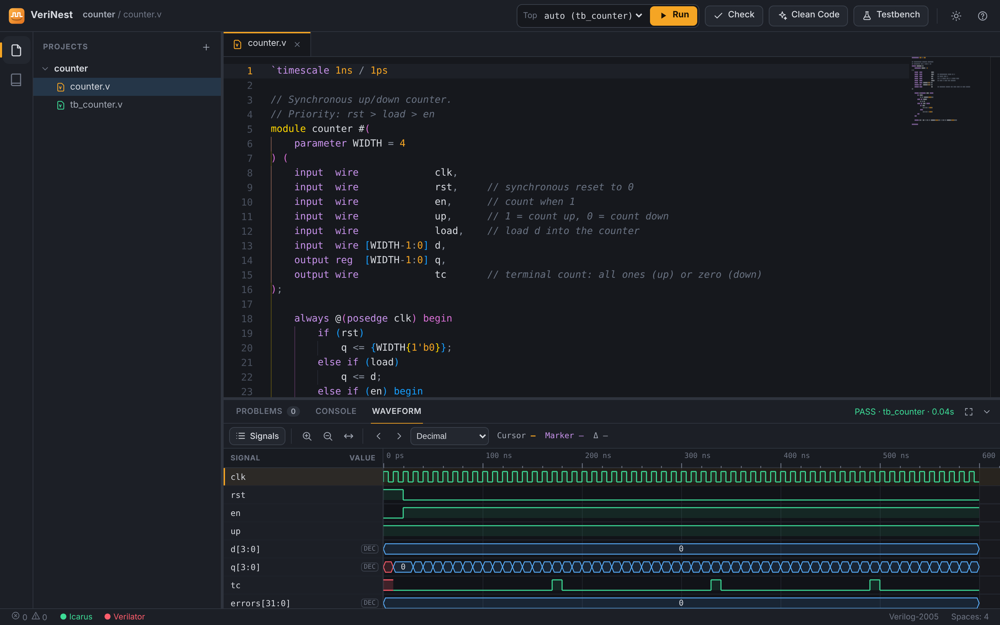
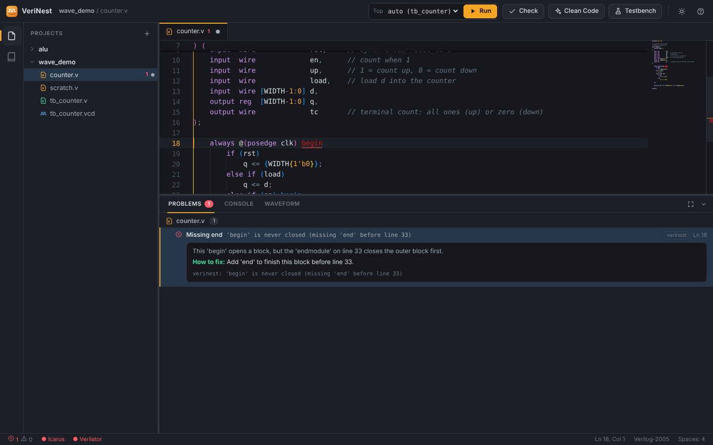
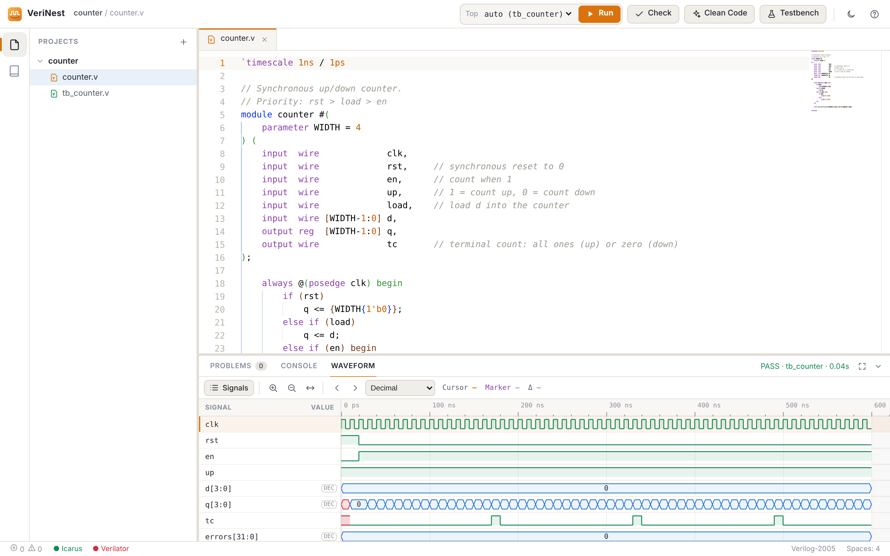
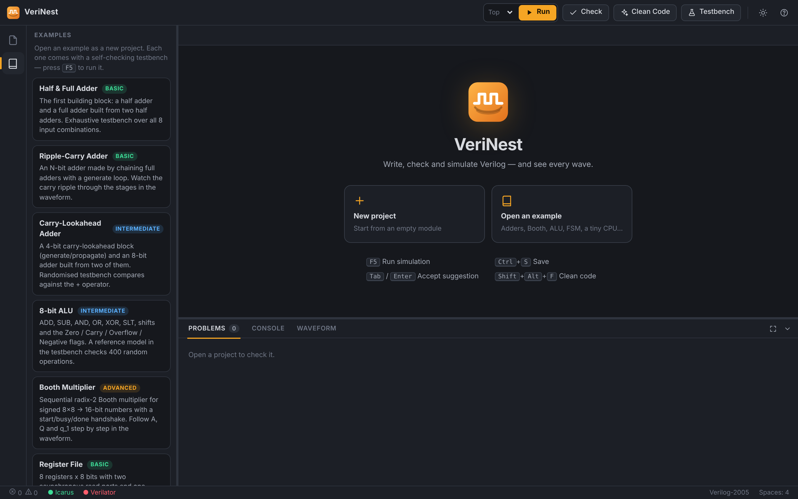

<p align="center">
  
</p>

<h1 align="center">VeriNest</h1>

<p align="center">
  A lightweight, offline desktop IDE for <b>learning and testing Verilog</b> on Linux.<br>
  Write a module, get instant explained errors, simulate with Icarus Verilog and inspect the waveforms, all in one window.
</p>

<p align="center">
  <a href="README.fa.md">فارسی</a> ·
  <a href="#installation">Installation</a> ·
  <a href="#usage">Usage</a> ·
  <a href="#contributing">Contributing</a>
</p>



## Why VeriNest?

Vivado, Quartus and ModelSim are huge, slow on modest laptops and overkill when you
just want to practise Verilog: an adder, a Booth multiplier, an ALU, an FSM or a small CPU.
VeriNest wraps free tools (Icarus Verilog, optionally Verilator) in a clean, modern
interface built for **learning**:

* error messages are explained in plain English, with a suggested fix;
* the editor suggests the next piece of code, and you accept it with <kbd>Tab</kbd>;
* the waveform viewer is built in, so you don't need a separate GTKWave window;
* it runs fully offline, starts in about a second and uses only a few hundred MB of RAM.

## Features

| | |
|---|---|
| **Editor** | The VS Code editor engine (Monaco) with Verilog highlighting, bracket colours, minimap, dark and light themes |
| **Inline suggestion** | One grey "ghost" suggestion as you type: <kbd>Tab</kbd> or <kbd>Enter</kbd> accepts it, <kbd>Esc</kbd> dismisses it. It completes block skeletons (`always`, `begin/end`, `case`, `if/else`, `module`…), instantiations of your own modules with every port connected, `$display`/`$dumpvars` arguments and names declared in the file. After accepting a block the cursor jumps inside it |
| **Auto Save** | Saves 1 s after you stop typing; click *Auto Save* in the status bar to turn it off |
| **Clean Code** | <kbd>Shift</kbd>+<kbd>Alt</kbd>+<kbd>F</kbd> re-indents and aligns declarations. It only changes whitespace, so it never breaks code |
| **Error checking** | Live while you type: Icarus Verilog, Verilator (if installed) and structural checks (unmatched `begin`/`end`, missing `;`…). Every problem has an **explanation** and a **how to fix** |
| **Testbench generator** | Creates a runnable testbench from any module: clock, reset, waveform dump and random stimulus |
| **Simulation** | <kbd>F5</kbd> compiles and runs. Console output with PASS/FAIL highlighting; runaway simulations without `$finish` are stopped with a clear message |
| **Waveform viewer** | Zoom, pan, cursor and marker with Δt, jump to next/previous edge, bin/hex/dec/signed values, signal tree with filter, drag to reorder. Also opens any `.vcd` file |
| **Examples** | Full adder, ripple-carry adder, carry-lookahead adder, 8-bit ALU, Booth multiplier, register file, counter, FSM sequence detector and a single-cycle CPU, all with self-checking testbenches |

<table>
<tr>
<td></td>
<td></td>
</tr>
<tr>
<td align="center">Errors with explanation and fix</td>
<td align="center">Light theme</td>
</tr>
</table>

## Installation

Tested on **Linux Mint 22 / Ubuntu 24.04**. It should also work on other Debian-based
distributions. Requirements: Python 3.8+, Icarus Verilog, and optionally Verilator.
No pip packages and no internet connection are needed after installation.

```bash
git clone https://github.com/mortezapourhoseini/verinest.git
cd verinest
./install.sh
verinest --selftest        # should end with: ALL EXAMPLES PASSED
```

`install.sh` does the following:

1. installs `iverilog` (required) and `verilator` (optional) with apt. If apt cannot
   download them (for example when plain-HTTP mirrors are blocked), it fetches the
   same `.deb` files over **HTTPS** and verifies each one's hash against your own apt
   package lists before installing;
2. copies the app to `~/.local/share/verinest`;
3. adds the `verinest` command (`~/.local/bin`) and a menu entry (**Programming → VeriNest**).

If `verinest` is "command not found" right after installing, log out and in again,
or run `~/.local/bin/verinest`.

### Manual install

```bash
sudo apt install iverilog verilator      # verilator is optional
python3 -m verinest                      # run from the repository folder
```

### Window

VeriNest is a small local web app (Python standard-library server + browser UI) shown in its
own window:

1. **Chrome / Chromium / Brave** in app mode (its own window, no tabs) if one of them is installed;
2. otherwise **pywebview**, if it is installed;
3. otherwise your default browser.

The server listens only on `127.0.0.1` and every API call needs a random per-session token.

### Uninstall

```bash
~/.local/share/verinest/uninstall.sh     # your projects in ~/VeriNest are kept
```

## Usage

1. **Open an example** (book icon on the left) or create a **New project**.
2. Edit the code. Problems appear as red/yellow underlines and in the **Problems** panel.
   Click a problem to see why it happens and how to fix it.
3. Press **F5**. VeriNest picks the testbench automatically (or choose the **Top** module),
   compiles, runs and opens the **Waveform**.
4. Click **Testbench** on any module file to generate a starting testbench.



### Keyboard shortcuts

| Key | Action |
|---|---|
| <kbd>F5</kbd> / <kbd>Ctrl</kbd>+<kbd>Shift</kbd>+<kbd>B</kbd> | Run simulation |
| <kbd>Ctrl</kbd>+<kbd>S</kbd> | Save |
| <kbd>Tab</kbd> / <kbd>Enter</kbd> | Accept the suggestion |
| <kbd>Shift</kbd>+<kbd>Alt</kbd>+<kbd>F</kbd> | Clean code |
| <kbd>Ctrl</kbd>+<kbd>Shift</kbd>+<kbd>L</kbd> | Check for errors |
| <kbd>Ctrl</kbd>+<kbd>J</kbd> | Show / hide the bottom panel |
| <kbd>F12</kbd> | Go to module definition |

**Waveform:** <kbd>Ctrl</kbd>+wheel zoom · drag to pan · click = cursor ·
<kbd>Shift</kbd>+click = marker · <kbd>←</kbd>/<kbd>→</kbd> jump to edges of the selected
signal · <kbd>F</kbd> fit · <kbd>Del</kbd> remove signal · click `DEC` to change the number format.

### Files

* Projects are plain folders: `~/VeriNest/projects/<project>/*.v`. Use them with any other tool too.
* Deleted files and projects are moved to `~/VeriNest/.trash/`.
* Simulations run inside the project folder, so `$readmemh("prog.hex")` works with relative paths.
* If the testbench has no `$dumpvars`, VeriNest records the waveform automatically.

### Command line

```
verinest              open the app
verinest --browser    open in the default browser
verinest --selftest   simulate every example and report PASS/FAIL
verinest --serve      run only the local server and print its URL
```

## Project structure

```
verinest/            Python backend (standard library only)
  server.py          local HTTP server + JSON API
  core.py            projects, examples, lint and simulation runners
  explain.py         tool output parsing + plain-English explanations
  vparse.py          lightweight Verilog parser (modules, ports, params, instances)
  formatter.py       whitespace-only code formatter
  tbgen.py           testbench generator
  vcd.py             VCD parser
web/                 front-end (vanilla JS, no build step)
  app.js             UI controller
  suggest.js         inline suggestion engine
  waveform.js        canvas waveform viewer
  vendor/monaco/     Monaco editor 0.40 (MIT)
examples/            example projects with self-checking testbenches
tools/fetch_deb.py   HTTPS fallback used by install.sh
```

## Roadmap ideas

* Yosys synthesis: RTL schematic and resource usage
* FSM diagram extracted from the code
* Save and restore waveform signal lists per project
* More suggestion rules and error explanations
* SystemVerilog subset, cocotb (Python) testbenches
* Packaging as `.deb` / AppImage

## Contributing

Contributions are welcome. New examples, better error explanations, suggestion rules,
bug fixes and translations are all great first contributions. See
[CONTRIBUTING.md](CONTRIBUTING.md).

## License

[MIT](LICENSE). Monaco Editor is © Microsoft, MIT licensed (`web/vendor/monaco/LICENSE`).
